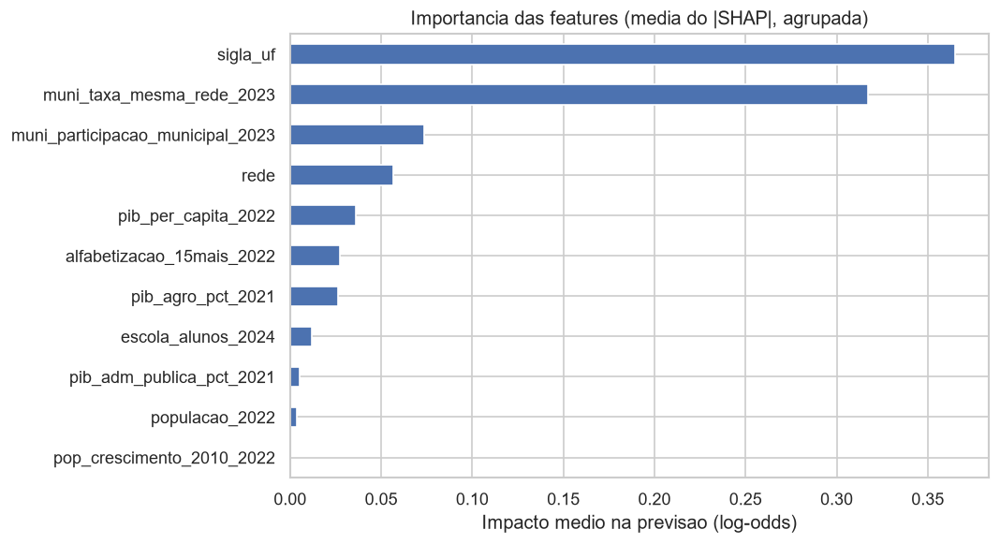
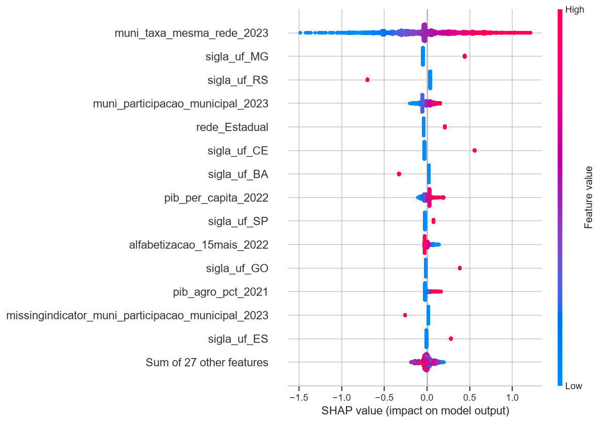
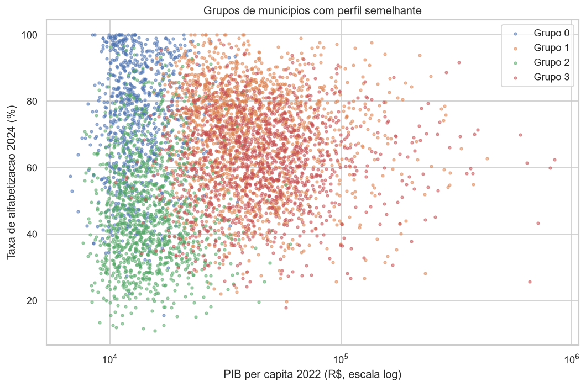

# Predição de Risco de Alfabetização no Brasil

**Tech Challenge Fase 3 - FIAP PosTech AI Scientist**

Modelo supervisionado que prevê se um aluno avaliado em 2024 está alfabetizado, a partir do contexto educacional do município no ano anterior e de indicadores socioeconômicos do IBGE, com foco em transformar a previsão em inteligência aplicável para gestores públicos.

> Continuação do projeto [brazil-literacy-lakehouse](https://github.com/JoaoPaulo-66/brazil-literacy-lakehouse) (Fase 2), que construiu o lakehouse (Bronze, Silver e Gold) do Indicador Criança Alfabetizada na AWS.

---

## Sumário

1. [Contexto do problema](#1-contexto-do-problema)
2. [Objetivo analítico](#2-objetivo-analítico)
3. [Descrição da base utilizada](#3-descrição-da-base-utilizada)
4. [Etapas de modelagem](#4-etapas-de-modelagem)
5. [Escolha do algoritmo](#5-escolha-do-algoritmo)
6. [Métricas de avaliação](#6-métricas-de-avaliação)
7. [Interpretação dos resultados](#7-interpretação-dos-resultados)
8. [Insights encontrados](#8-insights-encontrados)
9. [Limitações do projeto](#9-limitações-do-projeto)
10. [Aplicação prática para políticas públicas](#10-aplicação-prática-para-políticas-públicas)
11. [Possíveis evoluções futuras](#11-possíveis-evoluções-futuras)
12. [Estrutura do repositório e reprodução](#12-estrutura-do-repositório-e-reprodução)

---

## 1. Contexto do problema

O **Indicador Criança Alfabetizada** mede a proporção de alunos do 2º ano do ensino fundamental que atingem o padrão de alfabetização (proficiência de pelo menos **743 pontos** na avaliação). Em 2024, **59,8%** dos alunos avaliados das redes estaduais e municipais estavam alfabetizados, e só **53,3%** dos municípios atingiram a meta definida para o ano.

Olhar o resultado depois que ele acontece não basta para a gestão. Gestores precisam **antecipar riscos**, saber **quais municípios priorizar** e entender **quais fatores estão associados** ao resultado, para direcionar apoio técnico e recursos antes da próxima avaliação.

## 2. Objetivo analítico

1. **Prever** se um aluno estará alfabetizado usando apenas informação disponível **antes** da prova.
2. **Identificar** os fatores que mais influenciam a previsão (Feature Importance e SHAP).
3. **Responder** às perguntas de negócio:
   - Quais fatores mais impactam a alfabetização?
   - Quais municípios apresentam maior risco educacional?
   - Quais regiões possuem padrões semelhantes?
   - Como prever municípios que podem não atingir metas futuras?

**Premissa central:** o modelo deve ser útil para um município que ele **nunca viu**, porque é assim que um gestor o usaria. Toda a validação foi desenhada em torno disso (seção 4.3).

## 3. Descrição da base utilizada

### 3.1 Camada Gold e Silver da Fase 2 (AWS Athena)

| Base | Linhas | Conteúdo |
|---|---|---|
| `alunos_2024` | 1.851.828 | Alunos de 2024 que fizeram a prova (redes Estadual e Municipal): rede, UF, município, escola, peso amostral e o target `alfabetizado` |
| `escolas_2024` | 42.496 | Porte da escola (número de alunos avaliados) |
| `municipios_2023` | 5.514 | Indicador do município em 2023 por rede (taxa, média e participação) |
| `metas_municipais` | 36.624 | Metas municipais de 2024 a 2030 (rede Municipal), com resultado apenas para 2024 |

Extração em `src/preprocessing/extracao.py`, com `CAST` explícito porque os tipos do catálogo do Glue não são confiáveis.

### 3.2 Enriquecimento externo (API do IBGE)

Extraído em `src/preprocessing/externos.py` pela API de agregados v3 do IBGE (SIDRA), chave pelo código IBGE de 7 dígitos, com **100% dos 5.517 municípios dos alunos** encontrados.

| Feature | Fonte (tabela SIDRA) | Observação |
|---|---|---|
| `populacao_2022` | Censo 2022 (4709) | Porte do município |
| `pop_crescimento_2010_2022` | Censo 2022 (4709) | Taxa geométrica de crescimento |
| `alfabetizacao_15mais_2022` | Censo 2022 (9543) | Escolaridade dos adultos |
| `pib_per_capita_2022` | PIB dos Municípios (5938) | PIB 2022 / população do Censo 2022 |
| `pib_agro_pct_2021` | PIB dos Municípios (5938) | VAB agropecuária / VAB total |
| `pib_adm_publica_pct_2021` | PIB dos Municípios (5938) | Dependência econômica da prefeitura |

Problemas resolvidos e documentados:
- As variáveis de participação percentual do SIDRA vieram nulas pela API: foram **recalculadas pela definição oficial** (VAB do setor / VAB total).
- O VAB setorial municipal só está disponível **até 2021** (`...` para 2022 e 2023): as participações têm um ano de defasagem.
- Um município de GO teve **VAB total negativo** em 2021: as participações viram nulo por regra genérica (`VAB total <= 0`) e o imputador trata.
- A API devolve as respostas comprimidas em gzip mesmo sem solicitação: `baixar_json` descomprime.

### 3.3 Features finais (`src/preprocessing/features.py`)

- **Categóricas:** `rede`, `sigla_uf`
- **Numéricas:** `escola_alunos_2024`, `muni_taxa_mesma_rede_2023` (taxa do município em 2023 na mesma rede do aluno), `muni_participacao_municipal_2023` e as 6 do IBGE
- **Target:** `alfabetizado` (59,78% de positivos)
- **Peso amostral:** `peso_aluno`, usado como `sample_weight` no treino, como no indicador oficial

## 4. Etapas de modelagem

### 4.1 Análise exploratória (`notebooks/01_eda.ipynb`)

A EDA orientou diretamente as decisões de modelagem:

| Evidência | Decisão |
|---|---|
| `images/leakage_presenca.png`: a ausência na prova vira target 0 | Só alunos que fizeram a prova; `presenca` não é feature |
| `images/eda_02_escola_2023_vs_aluno_2024.png`: o `id_escola` é remascarado a cada ano | Histórico por escola descartado; da escola fica só o porte em 2024 |
| `images/eda_03_efeito_porte_escola.png` | Porte da escola entra como feature |
| `images/eda_04_municipio_2023_vs_aluno_2024.png`: taxa municipal de 2023 próxima da diagonal | Contexto municipal do ano anterior é a principal feature |
| `images/eda_05_correlacao_features.png` | Features municipais redundantes (correlação acima de 0,9) removidas |
| `images/eda_06_ibge_curvas_decis.png`: correlação linear quase nula, mas curvas por decil entre 53% e 66% | As 6 features do IBGE ficam (sinal não linear) |
| `images/eda_07_correlacao_features.png`: maior correlação de Spearman 0,86 | Sem redundância pelo mesmo critério de 0,9 |

**Hipótese testada e rejeitada (paradoxo de Simpson):** a alfabetização dos adultos teria relação positiva com o resultado infantil dentro de cada UF, mascarada no agregado nacional. Dentro das UFs, a relação foi positiva em só 12 de 25. Não há regra geral.

### 4.2 Tratamento de data leakage

1. **A proficiência define o target** (corte de 743) e não é extraída.
2. **Ausência vira target 0**: a população de treino é só quem fez a prova.
3. **Histórico de escola descartado** pelo remascaramento do `id_escola`.
4. **Nenhum resultado de 2024** como feature: o contexto vem de 2023 e os dados externos são de 2021 e 2022.
5. **Pré-processamento dentro do Pipeline**: imputação, padronização e encoding aprendem só com o treino de cada fold. Transformações que não aprendem com a base (`criar_features`) rodam antes do split.
6. **Split por município** (o leakage mais sutil, seção 4.3).

### 4.3 Split e validação por município

As features de contexto são **constantes dentro de cada município**. Num split aleatório, alunos de uma mesma cidade caem no treino e no teste: o modelo reconhece o município pelos valores exatos (por exemplo, a população) e aprende a taxa de 2024 dos colegas, o que equivale a usar o resultado da prova do mesmo ano.

Solução: `StratifiedGroupKFold` agrupado por município (`src/evaluation/validacao.py`).
- **Teste:** 20% dos municípios (1.160 municípios, 370.139 alunos), **zero municípios em comum** com o treino.
- **Validação cruzada:** 5 folds, também por município, dentro do treino.

**Prova numérica do leakage:** o mesmo LightGBM, nos mesmos dados, só mudando a forma de dividir:

| Split | ROC-AUC | Desvio entre folds |
|---|---|---|
| Por município | 0,664 | 0,013 |
| Aleatório | 0,681 | 0,002 |

O split aleatório infla o AUC em 1,7 ponto e deixa o resultado artificialmente estável, porque o modelo reconhece municípios já vistos.

### 4.4 Pipeline (`src/modeling/pipeline.py`)

Um `Pipeline` do scikit-learn por modelo, com `ColumnTransformer`:
- **Numéricas:** `SimpleImputer(median, add_indicator=True)`, que cria uma coluna sinalizando o valor ausente. Para a Regressão Logística, também `log1p` nas variáveis assimétricas (população, PIB per capita, porte da escola) e `StandardScaler`.
- **Categóricas:** `OneHotEncoder(handle_unknown="ignore")`.
- **Saída em pandas** (`set_output`), mantendo os nomes das features para o SHAP.
- Semente fixa (`SEMENTE = 42`) em split, CV e modelos.

### 4.5 Otimização

`RandomizedSearchCV` com a mesma validação por município (`notebooks/02_modelagem.ipynb`):
- Regressão Logística: força da regularização `C`.
- LightGBM: `n_estimators`, `learning_rate`, `num_leaves`, `min_child_samples`, `reg_lambda`.

A comparação e a busca usaram uma amostra de 300 mil alunos do treino (custo computacional). O modelo final foi retreinado no **treino completo** (1,48 milhão de alunos).

## 5. Escolha do algoritmo

Quatro modelos em ordem de complexidade, com o mesmo pipeline, split e validação. **Critério definido antes de ver os resultados:** um modelo mais complexo só substitui a Regressão Logística se superar sua ROC-AUC em pelo menos **2 pontos**.

| Modelo | ROC-AUC (CV) | Após otimização |
|---|---|---|
| Dummy (classe majoritária) | 0,500 | - |
| **Regressão Logística** | 0,664 | **0,6638** (C = 0,01) |
| Random Forest | 0,664 | - |
| LightGBM | 0,664 | 0,6656 |

**Modelo final: Regressão Logística (C = 0,01).** O LightGBM otimizado supera em só 0,18 ponto, abaixo do critério e do desvio entre folds (0,013). A Logística é mais simples, mais rápida e explicável para gestores (cada coeficiente diz se o fator aumenta ou reduz o risco). O LightGBM preferir árvores pequenas (15 folhas) indica pouca não linearidade a explorar.

## 6. Métricas de avaliação

- **ROC-AUC:** capacidade de ordenar alunos por risco, independente do corte.
- **Recall da classe "não alfabetizado":** proporção das crianças em risco que o modelo encontra. É a métrica prioritária para política pública: deixar de apontar uma criança em risco custa mais que um falso alarme.
- **Corte de decisão:** índice de Youden, escolhido **no treino** (0,596). Elevou o recall dos não alfabetizados de 38% (corte 0,5) para 70%.

### Resultado no teste (municípios nunca vistos)

| Métrica | Valor |
|---|---|
| ROC-AUC | **0,643** |
| Recall não alfabetizados | **0,697** |
| Precisão não alfabetizados | 0,481 (base: 0,40) |
| Recall alfabetizados | 0,494 |

**No nível do município**, que é onde o gestor age, a taxa prevista tem **correlação de 0,787** com a taxa real nos municípios do teste. A agregação cancela o ruído individual: o modelo é modesto para classificar um aluno e bom para ordenar municípios por risco.

**AUC dentro de cada UF:** entre 0,52 e 0,64 na maioria dos estados, com exceção do **CE (0,743)**. Grande parte do poder do modelo vem de saber em qual estado o aluno estuda (seção 8).

Arquivos: `reports/cv_comparacao_modelos.csv`, `reports/metricas_teste.csv`, `reports/auc_por_uf_teste.csv`.

## 7. Interpretação dos resultados

`notebooks/03_interpretabilidade.ipynb` e `src/evaluation/interpretabilidade.py`.

- **Feature Importance:** coeficientes da Regressão Logística (features numéricas padronizadas, portanto comparáveis).
- **SHAP:** `LinearExplainer` (exato para modelos lineares) em 20 mil alunos do teste, com 2 mil alunos de treino como referência. As 26 colunas de UF e as 2 de rede foram somadas para mostrar o peso real de cada feature original.



| Feature | Média do \|SHAP\| |
|---|---|
| UF | 0,365 |
| Taxa do município em 2023 (mesma rede) | 0,317 |
| Participação municipal 2023 | 0,074 |
| Rede | 0,057 |
| PIB per capita | 0,036 |
| Alfabetização adulta | 0,028 |
| Participação do agro no PIB | 0,026 |
| Demais | < 0,012 |



Leitura:
- **UF e taxa municipal de 2023 concentram cerca de 75% do impacto.** As 6 features do IBGE somam cerca de 0,10.
- **Histórico recente:** um município 1 desvio-padrão acima da média em 2023 multiplica a chance do aluno estar alfabetizado por cerca de **1,55** (coeficiente 0,439).
- **Efeito próprio do estado** (já descontado o histórico de 2023): CE, MG, GO e ES acima; **RS** (maior efeito negativo) e BA abaixo.
- **Rede estadual** com coeficiente maior que a municipal (0,249 x 0,032).
- **Ausência de dado municipal em 2023** aumenta o risco (-0,061): a falta de informação também é um sinal de alerta.
- **Alfabetização adulta com sinal negativo pequeno** (-0,036): efeito condicional à UF e ao histórico, associado às cidades grandes e correlacionado com o PIB per capita. Não deve ser lido como causal.
- A regularização zerou o crescimento populacional (seleção automática de variáveis).

> Os coeficientes e o SHAP explicam **o modelo**, não relações de causa e efeito. A leitura correta é "está associado a", não "causa".

## 8. Insights encontrados

`notebooks/04_negocio.ipynb` e `src/evaluation/negocio.py`.

### 8.1 O perfil socioeconômico não determina o resultado

Três evidências independentes apontam para a mesma conclusão:
1. **EDA:** a taxa municipal de 2023 tem correlação de só 0,04 com a alfabetização adulta e 0,05 com o PIB per capita.
2. **Modelo:** UF e histórico recente pesam muito mais que as variáveis do IBGE.
3. **Agrupamento de municípios** (KMeans, k = 4, sobre perfil socioeconômico e taxa de 2023):



| Grupo | Perfil | PIB per capita | Adultos alfabetizados | Taxa 2024 | UFs principais |
|---|---|---|---|---|---|
| 0 | Pobres, pequenos | R$ 12,7 mil | 80% | **74,0%** | CE, MG, MA |
| 2 | Pobres, pequenos | R$ 14,0 mil | 81% | **46,6%** | BA, MG, RN |
| 1 | Rurais com agro forte | R$ 37,9 mil | 92% | 69,5% | PR, MG, RS |
| 3 | Urbanos, maiores | R$ 42,9 mil | 94,5% | 62,0% | SP, MG, SC |

Os grupos 0 e 2 têm o **mesmo perfil socioeconômico e 27 pontos de diferença** no resultado. O grupo mais rico e urbano alfabetiza menos que o mais pobre. Parte da separação vem da taxa de 2023, que entrou no agrupamento, mas o recado se mantém: **pobreza não condena o resultado**.

### 8.2 O estado pesa mais que o município

O AUC dentro das UFs (0,52 a 0,64) é bem menor que o nacional, e a UF é a feature mais importante. A diferença entre estados sugere que **política educacional e gestão** são a principal alavanca. O CE, com o modelo funcionando bem também dentro do estado (AUC 0,743), é o caso de referência.

### 8.3 Municípios de maior risco

Ranking completo em `reports/municipios_risco.csv`. Entre os 20 de maior risco previsto (com pelo menos 30 alunos avaliados), **16 são da BA** e o restante do RN, com taxas previstas entre 19% e 26%.

### 8.4 Municípios que podem não atingir a meta

**Validação em 2024 (municípios do teste):** a taxa prevista da rede municipal foi comparada com a meta de 2024, após um ajuste de escala de +0,6 ponto entre microdados e indicador oficial, estimado só nos municípios de treino.

| | Previsto não atinge | Previsto atinge |
|---|---|---|
| **Não atingiu** | 316 | 214 |
| **Atingiu** | 138 | 427 |

- Dos municípios apontados pelo modelo, **69,6% de fato não atingiram** a meta, contra 48,4% ao acaso (**1,44 vez melhor**).
- O modelo encontrou **59,6%** dos que não atingiram. Acurácia de 68%.

**Projeção 2025** (resultado de 2024 no lugar da taxa de 2023): **47,7%** dos municípios previstos abaixo da meta, com RS, BA, AM, RJ e PA liderando. Arquivo: `reports/projecao_metas_2025.csv`.

> **Ressalva sobre o RS:** o estado teve resultado muito baixo em 2024 e a projeção o penaliza duas vezes (pelo histórico e pelo efeito da UF aprendido em 2024). Hipótese não testada: efeito das enchentes de maio de 2024. Se foi um choque pontual, a projeção do RS é pessimista.

## 9. Limitações do projeto

- **Sem dados individuais do aluno** (por LGPD): o modelo depende do contexto, o que limita a discriminação entre alunos da mesma escola e município.
- **AUC moderado no nível do aluno (0,643):** útil para priorizar, não para diagnosticar uma criança.
- **Forte dependência do ano anterior:** municípios pequenos com taxa atípica em 2023 são mal ordenados (por exemplo, Ermo/SC: previsto 24,9%, real 70%).
- **Projeção para 2025** assume que a relação entre um ano e o seguinte se mantém; não captura choques como o do RS.
- **Histórico por escola inutilizável** pelo remascaramento anual do `id_escola`.
- **VAB setorial com um ano de defasagem** (2021) em relação às demais variáveis do IBGE.
- **RR ausente** entre os alunos de 2024 das redes Estadual e Municipal.
- **Metas apenas da rede municipal** na camada Gold.
- **Interpretação associativa, não causal.**

## 10. Aplicação prática para políticas públicas

1. **Priorização de apoio técnico:** o ranking municipal (correlação de 0,787 com o resultado real em municípios não vistos) permite às secretarias estaduais direcionar formação de professores, material e acompanhamento aos municípios de maior risco **antes** da próxima avaliação.
2. **Alerta de metas:** a lista de municípios previstos abaixo da meta de 2025 acerta 1,44 vez mais que o acaso e pode orientar planos de ação ainda no início do ano letivo.
3. **Aprender com quem tem resultado acima do esperado:** municípios do grupo 0 (pobres, com 74% de alfabetização) são referências naturais para os do grupo 2 (mesmo perfil, 46,6%). Programas de cooperação entre municípios semelhantes, como o modelo de colaboração estado-município do Ceará, têm fundamento nos dados.
4. **Qualidade da informação:** municípios sem dado no ano anterior têm maior risco previsto; garantir participação na avaliação é também uma ação de gestão.
5. **Uso responsável:** o modelo indica **onde olhar**, não substitui o diagnóstico local; projeções de estados com choques recentes, como o RS, exigem leitura crítica.

## 11. Possíveis evoluções futuras

- Incorporar dados da escola e do professor do **Censo Escolar** (infraestrutura, formação docente, rotatividade) para melhorar a discriminação dentro dos municípios.
- Variáveis de financiamento (**FUNDEB**) e vulnerabilidade (**Cadastro Único**).
- Testar a hipótese das enchentes no RS com dados de interrupção escolar em 2024.
- Modelos hierárquicos (aluno, escola, município, estado) para separar formalmente o efeito de cada nível.
- Avaliação temporal completa assim que o resultado de 2025 estiver disponível (treinar em 2023 para 2024 e validar em 2024 para 2025).
- Painel interativo para secretarias com o ranking de risco e a projeção de metas.

## 12. Estrutura do repositório e reprodução

```
tech-challenge-fase3/
├── data/
│   ├── raw/                    # bases extraídas (não versionadas)
│   └── processed/              # modelo treinado (não versionado)
├── notebooks/
│   ├── 01_eda.ipynb
│   ├── 02_modelagem.ipynb
│   ├── 03_interpretabilidade.ipynb
│   └── 04_negocio.ipynb
├── src/
│   ├── preprocessing/          # extracao.py, externos.py, montagem.py, features.py
│   ├── modeling/               # pipeline.py
│   ├── evaluation/             # validacao.py, metricas.py, interpretabilidade.py, negocio.py
│   └── visualization/          # graficos.py
├── reports/                    # métricas, rankings e projeções em CSV
├── images/                     # figuras por etapa (eda_, interp_, negocio_)
├── requirements.txt
└── README.md
```

Os notebooks só importam e chamam funções de `src/`; toda a lógica está nos módulos.

### Como reproduzir

Pré-requisitos: Python 3.14, credenciais AWS com acesso ao lakehouse da Fase 2 (`aws configure`, região `sa-east-1`).

```powershell
python -m venv venv
.\venv\Scripts\python.exe -m pip install -r requirements.txt

# Extração (Athena) e enriquecimento (API do IBGE)
.\venv\Scripts\python.exe -m src.preprocessing.extracao
.\venv\Scripts\python.exe -m src.preprocessing.externos
```

Depois, executar os notebooks em ordem (01 a 04). O notebook 02 salva o modelo final em `data/processed/modelo_final.joblib`, usado pelos notebooks 03 e 04.

### Versionamento

Uma branch e um pull request por etapa (`extracao`, `eda`, `enriquecimento`, `pipeline`, `interpretabilidade`, `docs`), com commits no padrão Conventional Commits.
